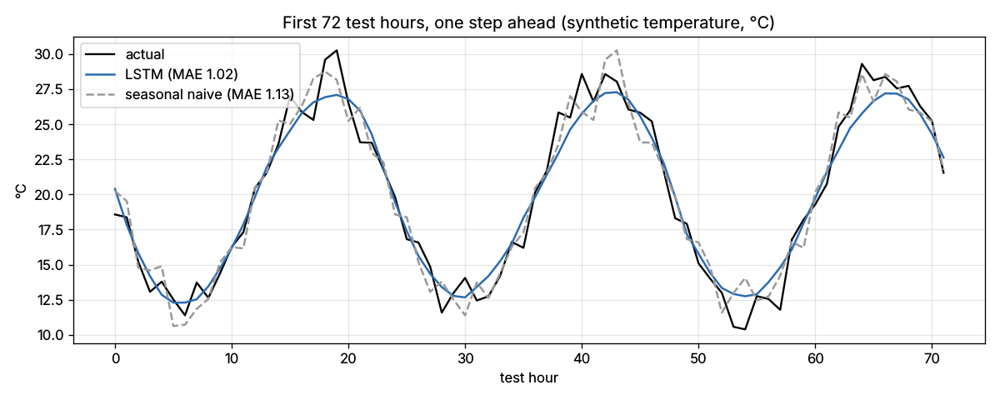
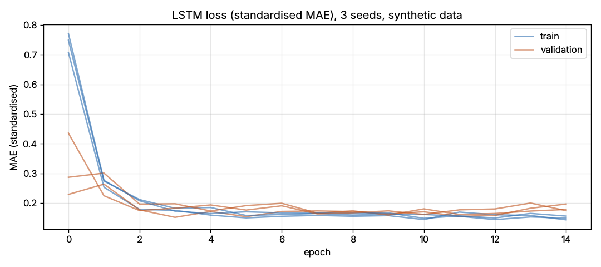

# Weather Time-Series Forecasting

A stacked LSTM for one-step-ahead hourly temperature, compared on a held-out test split with
persistence, seasonal-naive and SARIMA baselines. The data is **synthetic**: a 24 h cycle plus
Gaussian noise, so the noise floor is known.

[](https://github.com/VenkataVinesh/Weather-Time-Series-Forecasting/actions/workflows/ci.yml)




## Quick start

```bash
git clone https://github.com/VenkataVinesh/Weather-Time-Series-Forecasting.git
cd Weather-Time-Series-Forecasting
pip install -r requirements.txt        # CPU is enough; about 10 s for 3 seeds
python train.py                        # prints the results table, writes results.json and both plots
pip install -r requirements-dev.txt && pytest -q
```

## How it works

| | |
|---|---|
| Data (`data_loader.py`) | 720 synthetic hours: temperature `20 + 8 sin(2πt/24) + N(0,1)`, humidity anti-correlated with it, pressure a random walk. The target is next-hour temperature |
| Splits | Chronological 70 / 15 / 15 (train / validation / test). Nothing is shuffled across time |
| Scaling | Standardisation fitted on the **training slice only**, saved in `lstm.pt` with the weights |
| Windows | 24 past hours of all three features predict hour t. A window may look back across a split boundary, but every target stays inside its own split |
| Model (`lstm_model.py`) | 2-layer LSTM, 32 hidden units, dropout 0.2, linear head. L1 loss, Adam (lr 0.005), 15 epochs. The epoch with the best **validation** loss is kept |
| Baselines (`baselines.py`) | Persistence (y(t−1)); seasonal naive (y(t−24)); SARIMA(1,0,0)(1,0,0)₂₄ fitted on the training slice and filtered forward with fixed parameters |

## Results

`python train.py`: 108 test hours, 3 seeds for the LSTM. MAE in °C, on **synthetic** data:

| Model | Test MAE (°C) |
|---|---:|
| Persistence | 1.71 |
| SARIMA(1,0,0)(1,0,0)₂₄ | 1.14 |
| Seasonal naive (24 h) | 1.13 |
| **LSTM** | **1.03 ± 0.01** |
| *Noise floor (MAE of N(0,1))* | *0.80* |

How to read it: the noise floor is the best any model could do. Seasonal naive's 1.13 equals the
theory exactly (√2 × 0.80, since it subtracts two noisy points). The LSTM beats it by smoothing
across the window instead of copying one noisy hour, and closes about 30% of the gap to the
floor. The test set is small (108 points), so treat the ranking between SARIMA and seasonal naive
as a tie.



## Limitations

- **Synthetic data only.** On a clean sinusoid an LSTM has an easy job. The value here is the
  evaluation harness (causal splits, train-only scaling, baselines, a known noise floor), not the
  number. Swapping in a real station series means replacing `generate_synthetic_weather`.
- One-step-ahead only. Multi-step forecasting would need recursive or direct heads, and
  probabilistic outputs.
- Small test set, no hyperparameter search.

## Project layout

```
data_loader.py   synthetic generator, chronological split, scaler, window dataset
lstm_model.py    stacked LSTM
baselines.py     persistence, seasonal naive, SARIMA (causal one-step)
train.py         training, evaluation, plots, results.json
tests/           pytest: split order, train-only scaling, causal windows and baselines
```

## License

MIT, see [LICENSE](LICENSE).
